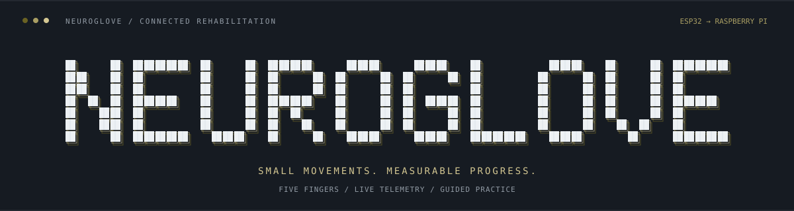
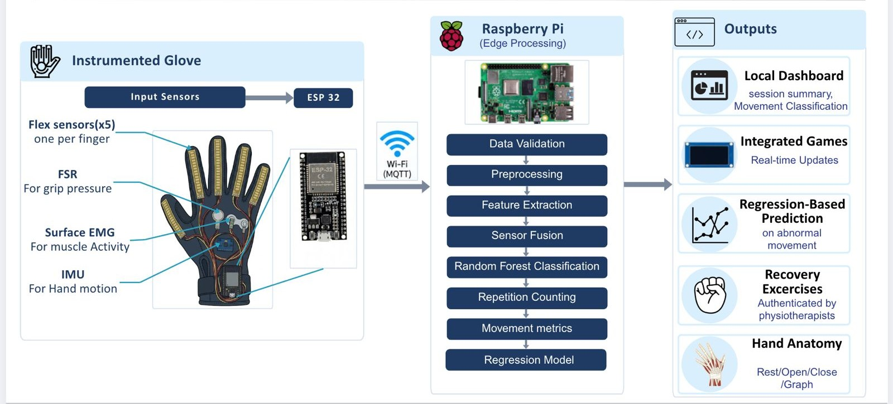

<p align="center">
  
</p>

<p align="center">
  <strong>A connected glove that brings hand movement, guided practice, and progress into one workspace.</strong>
</p>

<p align="center">
  <a href="#the-experience">Experience</a> &nbsp;·&nbsp;
  <a href="#the-hardware">Hardware</a> &nbsp;·&nbsp;
  <a href="#getting-started">Get started</a> &nbsp;·&nbsp;
  <a href="#running-on-raspberry-pi">Raspberry Pi</a>
</p>

<p align="center">
  
  
  
  
  
  
</p>

---

## Why NeuroGlove?

Rehabilitation progress is built from repeated, everyday movements. NeuroGlove makes those movements visible: how a finger bends, how the wrist turns, and how grip pressure changes during practice.

Five flex sensors, a wrist IMU, and a palm pressure sensor feed a live dashboard through an ESP32. A Raspberry Pi runs the application, turning incoming readings into an interactive hand mirror, guided activities, and session history that can be reviewed over time.

## The experience

<table>
  <tr>
    <td width="50%" valign="top">
      <h3>01 / See every movement</h3>
      <p>A responsive 3D hand mirrors all five fingers and wrist orientation. Live charts show finger flexion, grip pressure, and wrist motion alongside movement classification.</p>
    </td>
    <td width="50%" valign="top">
      <h3>02 / Practise with guidance</h3>
      <p>Six exercises pair a demonstration with the patient's live hand. Patient-paced scoring tracks movement targets, completed rounds, and session averages.</p>
    </td>
  </tr>
  <tr>
    <td valign="top">
      <h3>03 / Make practice engaging</h3>
      <p>Pick fruit in <strong>The Orchard</strong>, bend a selected finger in <strong>Kangaroo Hop</strong>, or guide a balloon with wrist movement in <strong>Sky Journey</strong>. Personal bests are saved between sessions.</p>
    </td>
    <td valign="top">
      <h3>04 / Follow progress</h3>
      <p>Explore interactive exercise graphs, daily achievement, and session history. Export PDF and CSV reports, and view experimental estimates for reaching a selected practice goal.</p>
    </td>
  </tr>
  <tr>
    <td valign="top">
      <h3>05 / Make the glove personal</h3>
      <p>Capture open, closed, and natural resting positions, then calibrate a comfortable squeeze and full release. Saved sensor ranges adapt the dashboard to the wearer.</p>
    </td>
    <td valign="top">
      <h3>06 / Explore and understand</h3>
      <p>Inspect an interactive hand anatomy model with layer controls. Use the workspace in <strong>English, Hindi, or Marathi</strong>, with a consistent Poppins-led interface.</p>
    </td>
  </tr>
</table>

## Six movements. One daily practice.

| Exercise | Movement focus |
|---|---|
| **Hand Opening & Closing** | Close all five fingers, then open and relax. |
| **Individual Finger Movement** | Bend and release each finger; complete all five for one round. |
| **Thumb Opposition** | Follow thumb-to-fingertip practice; feedback uses the thumb's bend pattern. |
| **Wrist Flexion & Extension** | Lift and lower the wrist, returning to the centre. |
| **Grip & Release Pressure** | Hold a comfortable squeeze, then fully release. |
| **Forearm Rotation** | Turn the palm upward and downward around a resting orientation. |

Individual-finger practice allows natural movement in neighbouring fingers. Grip practice accepts a comfortable pressure band rather than demanding one exact force. Sessions follow the patient's pace.

## The hardware


| Component | Purpose | ESP32 connection |
|---|---|---|
| Flex sensor — thumb | Thumb bending | GPIO36 / VP |
| Flex sensor — index | Index finger bending | GPIO34 |
| Flex sensor — middle | Middle finger bending | GPIO32 |
| Flex sensor — ring | Ring finger bending | GPIO35 |
| Flex sensor — little finger | Little finger bending | GPIO39 / VN |
| FSR | Palm contact and grip pressure | GPIO33 |
| MPU6050 | Wrist and forearm motion | SDA GPIO21 · SCL GPIO22 |
| Raspberry Pi | Application hosting, processing, and storage | Wi-Fi network |

The analog sensor inputs use ADC1 pins so they can operate alongside ESP32 Wi-Fi. Use the appropriate sensor voltage-divider circuits and a common ground; keep ESP32 analog inputs within 3.3 V.

## From glove to dashboard

<p align="center">
  
</p>

MQTT carries wireless readings from the glove to the Pi. USB serial is available for direct connections. The backend processes incoming frames and streams updates to the browser through Server-Sent Events. SQLite stores calibration, exercise history, and game records locally.

The React interface integrates the established canvas and Three.js controllers, retaining their movement rendering and game behaviour. Vite builds the frontend, and Flask serves the finished application and its APIs together.

## Getting started

You need **Python 3.11+**, **Node.js 20.19+ or 22.12+**, Git, and either an ESP32 USB connection or a reachable MQTT broker.

```bash
git clone https://github.com/college-hack24-nov26/hack-synapse.git
cd hack-synapse
python -m venv .venv
```

Activate the Python environment:

```powershell
# Windows PowerShell
.\.venv\Scripts\Activate.ps1
```

```bash
# Raspberry Pi / Linux
source .venv/bin/activate
```

Install dependencies and build the interface:

```bash
python -m pip install -r requirements.txt
npm ci
npm run build
```

### Connect over USB

Close Arduino Serial Monitor so the application can open the port. Replace the device name with the port assigned to your ESP32.

```powershell
# Windows
python run.py --source serial --serial-port COM11 --host 127.0.0.1 --port 5001
```

```bash
# Raspberry Pi / Linux
python run.py --source serial --serial-port /dev/ttyUSB0 --host 0.0.0.0 --port 5001
```

The firmware sends twelve comma-separated values at **115200 baud**:

```text
thumb,index,middle,ring,pinky,fsr,acc_x,acc_y,acc_z,gyro_x,gyro_y,gyro_z
```

### Connect over Wi-Fi

Configure the ESP32 and broker with matching credentials and MQTT topic `neuroglove/sensors/data`. The broker uses port **1883** in the current deployment.

Set these environment variables before starting the application:

```powershell
# Windows PowerShell — replace placeholders with your local settings
$env:MQTT_BROKER_HOST = "YOUR_BROKER_IP"
$env:MQTT_BROKER_PORT = "1883"
$env:MQTT_USERNAME = "YOUR_MQTT_USERNAME"
$env:MQTT_PASSWORD = "YOUR_MQTT_PASSWORD"
python run.py --source mqtt --host 0.0.0.0 --port 5001
```

```bash
# Raspberry Pi / Linux
export MQTT_BROKER_HOST="127.0.0.1"
export MQTT_BROKER_PORT="1883"
export MQTT_USERNAME="YOUR_MQTT_USERNAME"
export MQTT_PASSWORD="YOUR_MQTT_PASSWORD"
python run.py --source mqtt --host 0.0.0.0 --port 5001
```

Open **[localhost:5001](http://localhost:5001/)** on the hosting computer, or `http://YOUR_PI_IP:5001/` from another device on the same network.

## Running on Raspberry Pi

The Pi hosts both the website and sensor processing. Once the React build is created, Node.js is not needed to serve the application.

The deployment service runs the app from `/home/pi/NeuroGlove-React` and reads broker settings from `/home/pi/.config/neuroglove/react.env`. Adjust these paths and the service user for your installation.

<details>
<summary><strong>Enable automatic startup</strong></summary>

After installing dependencies, building the frontend, and configuring the broker environment:

```bash
sudo cp deployment/neuroglove-react.service /etc/systemd/system/
sudo systemctl daemon-reload
sudo systemctl enable --now mosquitto neuroglove-react
```

Check the application:

```bash
systemctl status neuroglove-react
journalctl -u neuroglove-react -n 50 --no-pager
hostname -I
```

The service starts the dashboard on port **5001** and restarts it if the process exits.

</details>

## Development & verification

For frontend changes, start the backend and Vite in separate terminals:

```bash
# Terminal 1
python server.py --source mqtt --port 5002

# Terminal 2
npm run dev
```

Open **[localhost:5173](http://localhost:5173/)**. Vite forwards API, sensor-stream, model, and video requests to the backend on port 5002.

```bash
# Backend regression checks
python -m unittest discover -s tests -p "test_*.py"

# Kangaroo Hop gesture checks
node tests/test_kangaroo_input.cjs

# Frontend production build
npm run build

# Browser checks — backend on port 5002, with live readings available
npx playwright test
```

The browser checks use Microsoft Edge. The regression checks cover calibration, finger rounds, pressure tolerance, EMG visualisation, and jump controls.

## Built with

**React · Vite · Poppins · Three.js · Chart.js · Flask · Python · SQLite · MQTT · ESP32 · MPU6050 · Raspberry Pi**

Third-party hand assets and fonts retain their accompanying credit and license files. Local credentials, patient databases, generated reports, and development caches are excluded from version control.

---

<p align="center">
  <strong>NeuroGlove</strong><br />
  <sub>Make movement visible. Make practice count.</sub>
</p>
